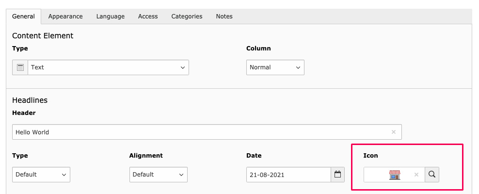

<div align="center">


# TYPO3 extension `bw_icons`

[](https://extensions.typo3.org/extension/bw_icons)
[](https://extensions.typo3.org/extension/bw_icons)
[](https://packagist.org/packages/blueways/bw-icons)
[](https://github.com/maikschneider/bw_icons/actions/workflows/tests.yml)
[](https://github.com/maikschneider/bw_icons/actions/workflows/sca.yml)
[](https://codecov.io/gh/maikschneider/bw_icons)
[](LICENSE.md)

</div>

Icon picker for TCA, Content Blocks and CKEditor. Generates a browsable gallery
of your icon fonts and SVGs: link the stylesheet or image folder you already use
in the frontend. Works with Font Awesome, Icomoon and other icon fonts.



## ✨ Features

* Form element `iconSelection` for your own TCA fields and Content Blocks
* Optional icon field for `tt_content`, `pages` and `sys_category`
* CKEditor plugin to insert icons into rich text
* Icons from image folders or icon fonts (CSS), local or remote
* Frontend include of the extracted icon stylesheets

## 🔥 Installation

```bash
composer require blueways/bw-icons
```

Or download it from the [TYPO3 Extension Repository](https://extensions.typo3.org/extension/bw_icons).

| Dependency | Version |
|---|---|
| PHP | `8.2` – `8.5` |
| TYPO3 | `13.4` or `14.3` |

## ⚙️ Configuration

Configure the icon sources in page TSconfig:

```typo3_typoscript
mod.tx_bwicons {
    fontawesome = Blueways\BwIcons\Provider\CssIconProvider
    fontawesome {
        title = Font Awesome
        file = fileadmin/fontawesome/css/all.css
    }
}
```

Then enable the icon field in the extension configuration or add the render
type to your own field:

```php
'icon' => [
    'label' => 'Icon',
    'config' => [
        'type' => 'input',
        'renderType' => 'iconSelection',
    ],
],
```

## 📙 Documentation

Icon providers, Content Blocks, CKEditor, frontend rendering and the upgrade
to 5.0: [docs.typo3.org](https://docs.typo3.org/p/blueways/bw-icons/main/en-us/).

## 🧑‍💻 Contributing

Issues and pull requests are welcome on
[GitHub](https://github.com/maikschneider/bw_icons).

Thanks to [blueways](https://www.blueways.de/) and [XIMA](https://www.xima.de/)!

## ⭐ License

This project is licensed under [GNU General Public License 2.0 (or later)](LICENSE.md).
